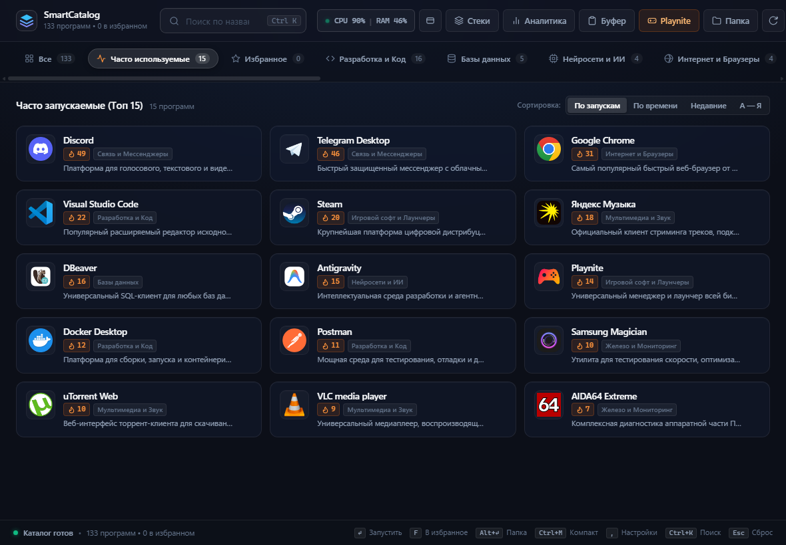
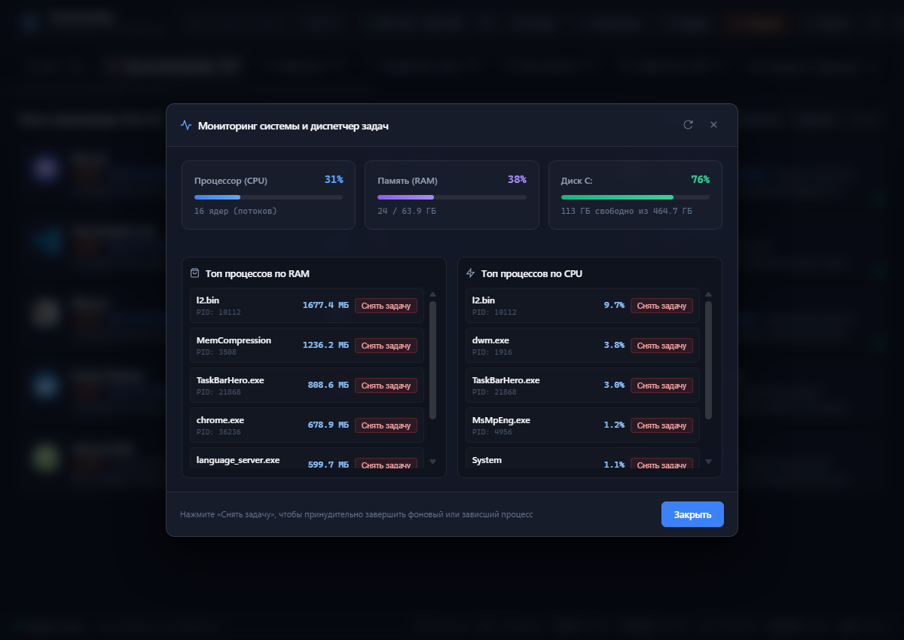
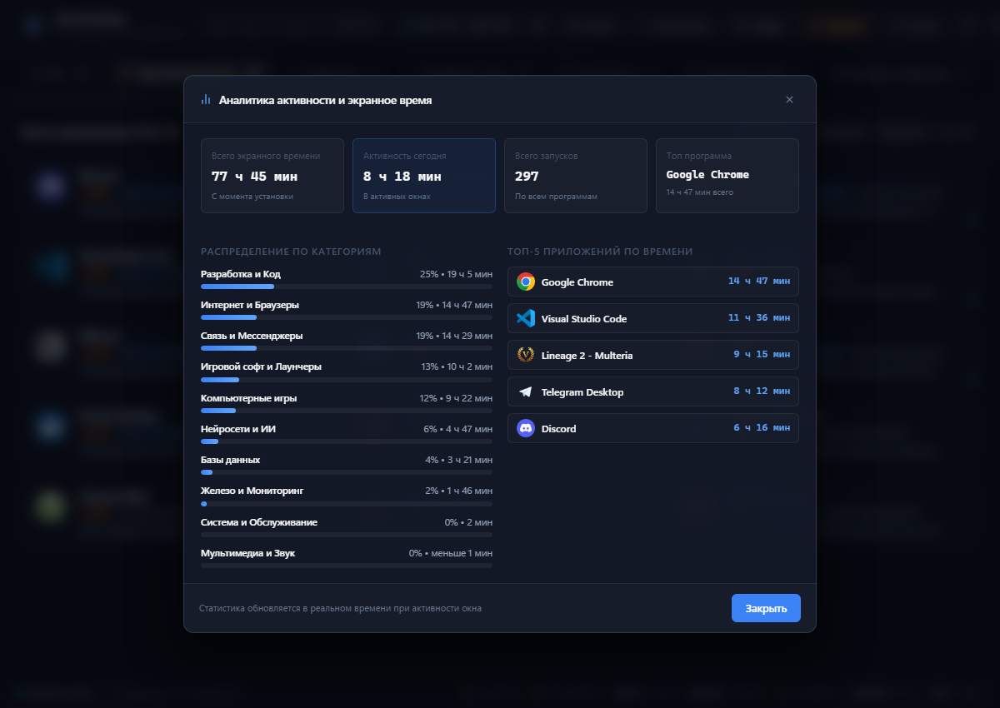
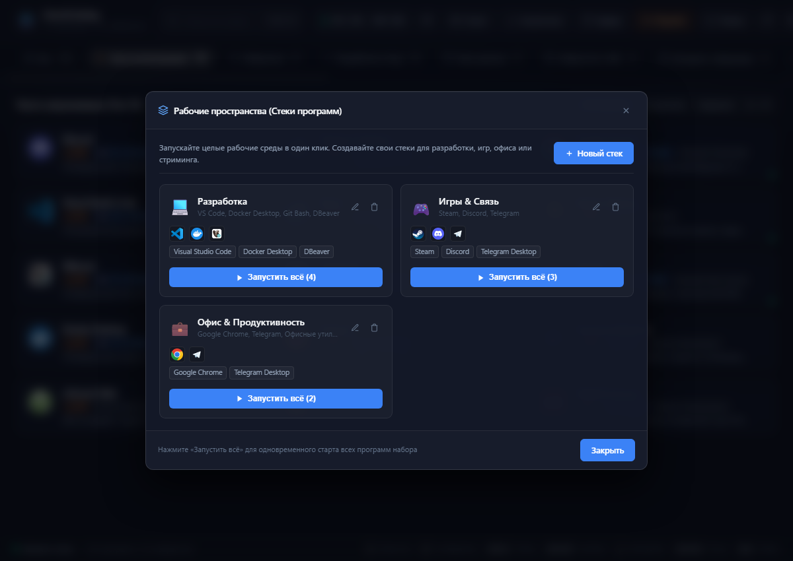

<p align="center">
  
</p>

<h1 align="center">SmartCatalog Hub</h1>

<p align="center">
  <b>Современный лаунчер приложений, органайзер меню «Пуск» и центр мониторинга для Windows 10 & 11</b>
</p>

<p align="center">
  
  
  
  
  
</p>

---

## О проекте

**SmartCatalog Hub** — это легковесный, быстрый и эстетичный командный центр для Windows. Он автоматически сканирует установленное программное обеспечение, распределяет программы по тематическим категориям, отслеживает добавление нового ПО в реальном времени через системные события ядра и предоставляет удобную витрину быстрого запуска с глобальной горячей клавишей.

### Главный экран каталога


---

## Ключевые возможности

### 🚀 Автоматическая каталогизация на лету
* **Ядерный мониторинг (`ReadDirectoryChangesW`)**: фоновый сервис мгновенно реагирует на появление новых ярлыков при установке программ, не расходуя процессорное время в ожидании (0% CPU).
* **13 категорий программ**: автоматическая раскладка (Разработка, Базы данных, ИИ/Нейросети, Браузеры, Мессенджеры, VPN/Сеть, Мультимедиа, Игры, Офис, Системные утилиты и др.).
* **Интеллектуальная фильтрация мусора**: деинсталляторы, справки и ссылки на сайты авторов автоматически отсеиваются.
* **Высокое разрешение иконок**: прямое извлечение 128×128 и 256×256 иконок из бинарных PE-файлов.

---

### ⚡ Производительность и Мониторинг
Встроенный диспетчер задач и монитор системных ресурсов позволяет в реальном времени отслеживать состояние оборудования и безопасно завершать зависшие процессы в один клик.



* **Мониторинг ресурсов**: загрузка CPU, использование RAM и свободное место на диске.
* **Топ процессов**: раздельные списки наиболее прожорливых процессов по оперативной памяти и процессору.
* **Защита целостности ОС**: блокировка случайного завершения системных процессов Windows (`System`, `csrss`, `dwm` и др.).

---

### ⏱ Аналитика экранного времени и Рабочие пространства
| Аналитика экранного времени | Рабочие пространства (Стеки) |
| :---: | :---: |
|  |  |
| Умный трекер экранного времени и частоты запуска приложений с разбивкой по категориям. | Одновременный запуск наборов приложений для работы, игр или стриминга в 1 клик. |

---

### ⌨️ Горячие клавиши (Hotkeys)

| Сочетание | Действие |
| :--- | :--- |
| <kbd>Alt</kbd> + <kbd>C</kbd> | Глобальный вызов / скрытие SmartCatalog Hub из любого приложения |
| <kbd>Ctrl</kbd> + <kbd>K</kbd> | Мгновенный фокус на строку поиска |
| <kbd>Ctrl</kbd> + <kbd>M</kbd> | Переключение между полным и компактным режимом (Mini Launcher) |
| <kbd>Esc</kbd> | Закрытие модальных окон или скрытие приложения |
| <kbd>Enter</kbd> | Запуск выбранной программы |

> **Умный поиск**: поиск понимает опечатки и автоматическую смену раскладки клавиатуры (`ghbkj;tybt` $\rightarrow$ `приложение`, `vsc` $\rightarrow$ `Visual Studio Code`).

---

## Установка и Запуск

### Вариант 1. Установщик Windows (Рекомендуется для пользователей)
1. Перейдите в раздел [Releases](https://github.com/your-username/SmartCatalog-Hub/releases).
2. Скачайте актуальный файл `SmartCatalog-Setup-v1.0.0.exe`.
3. Запустите мастер установки и следуйте простым подсказкам на экране.

---

### Вариант 2. Запуск из исходного кода (Для разработчиков)

**Требования**: Windows 10/11 x64, Python 3.10 или новее.

1. **Клонируйте репозиторий**:
   ```bash
   git clone https://github.com/your-username/SmartCatalog-Hub.git
   cd SmartCatalog-Hub
   ```

2. **Запустите автоматический установщик**:
   ```bat
   install.bat
   ```
   Скрипт автоматически создаст виртуальное окружение `venv`, установит необходимые зависимости (`requirements.txt`), зарегистрирует фоновую службу автозапуска в Планировщике Windows и запустит приложение.

3. **Ручной запуск (при необходимости)**:
   ```bash
   # Запуск фоновой службы
   python service.py

   # Открытие клиентского окна
   python app.py
   ```

4. **Чистое удаление службы**:
   ```bat
   uninstall.bat
   ```

---

## Архитектура проекта

```
SmartCatalog-Hub/
├── assets/                  # Иконка приложения и промо-скриншоты
├── static/                  # Веб-клиент (HTML5, Vanilla JS, Fluent CSS)
│   ├── index.html           # Интерфейс приложения
│   ├── style.css            # Fluent 2 стили и анимации
│   └── app.js               # Клиентская логика и интеграция с API
├── app.py                   # Оконный клиент (Edge Webview / App mode)
├── service.py               # Фоновая служба Windows
├── server.py                # HTTP API сервер (на стандартной библиотеке http.server)
├── watcher.py               # ReadDirectoryChangesW мониторинг ФС
├── catalog_manager.py       # Диспетчер каталога, запуск ПО и сбор метрик
├── classifier.py            # Движок категорий и правил метаданных
├── icon_extractor.py        # Извлечение иконок из PE-заголовков Windows
├── tray_and_hotkey.py       # Системный трей и глобальные хоткеи (Alt+C)
├── install_autostart.py     # Регистрация автозапуска в Windows Task Scheduler
├── install.bat              # Скрипт развёртывания в 1 клик
├── uninstall.bat            # Скрипт чистого удаления
└── requirements.txt         # Зависимости Python
```

---

## Безопасность

Проект протестирован на устойчивость к типовым векторам атак:
* **Защита от Path Traversal (CWE-22)**: строгая проверка канонических путей `realpath` при отдаче файлов и иконок.
* **CORS & CSRF защита (CWE-346/352)**: проверка `Origin` и `Sec-Fetch-Site` для блокировки внешних запросов из браузера.
* **Защита от DoS**: ограничение размера входящих пакетов (2 MB) и лимитирование частоты записи на диск.

---

## Лицензия

Распространяется под свободной лицензией [MIT](LICENSE). Вы можете бесплатно использовать, изменять и распространять данный проект.
